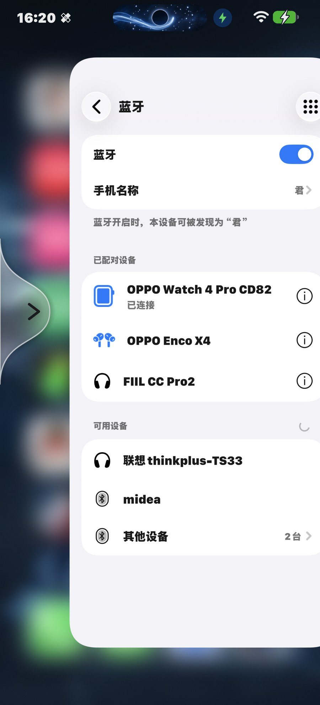

# 侧滑返回样式 · SideBackStyle

给 ColorOS 侧滑返回手势换一套「图标 + 背景」的 LSPosed 模块。

一个独立的 LSPosed 模块：只做 ColorOS 侧滑返回的图标与背景美化，代码、配置、构建都自包含，不依赖其他应用。

> 适用：ColorOS 16 / 17（Android 16 / 17），SystemUI 使用 `com.oplus.systemui.navigationbar.gesture.sidegesture.SideGestureDetector` 的机型。
> 已在 OPPO Find X8 Ultra（PKU110，ColorOS 17 / Android 17）实机验证：LSPosed 2.2.1 启用后侧滑手势正常绘制玻璃水滴与图标。

## 下载

- [Releases](https://github.com/Troublemaker2333/SideBackStyle/releases/latest)：`SideBackStyle-1.2.apk`
- 也可以直接下载仓库里的 [dist/SideBackStyle-1.2.apk](dist/SideBackStyle-1.2.apk)

---

## 截图

| 液态玻璃 + 拖尾 | 图标「透明」 | 箭头跟随方向 |
| --- | --- | --- |
|  |  |  |

| 设置页 | 拖尾过程动效 | 右缘滑动 |
| --- | --- | --- |
|  |  |  |

---

## 功能

- **图标**：箭头、圆点、爱心、星星、闪电、猫爪、自定义图片（PNG / WebP / GIF）、透明
- **颜色**：8 个预设 + HSV 拾色器（色相/饱和度/明度、HEX 输入）
- **尺寸**：0–100% 滑杆，映射 8–72dp；支持图标偏移（最多到屏幕中线）与左右镜像
- **背景**：系统原样 / 纯色 / 线性或径向或扫描渐变（角度、三色、中间色位置）/ 液态玻璃 / 无
- **液态玻璃**：半透明着色 + 磨砂噪点 + 顶部高光 + 底部折射 + 双层高光描边 + 柔和投影，磨砂强度 0–100%
- **过程动效**（滑动过程中可见，不是待机循环）：拖尾、粒子、残影、弹性、波纹
- **实时预览**：设置页直接预览，可固定预览卡片不随列表滚动
- **配置通道**：模块自己的 SharedPreferences + 只读 ContentProvider（`com.junjun.sideback.config`），SystemUI 内 700ms 缓存，改完下一次手势即生效

## 兼容性

| 项目 | 说明 |
| --- | --- |
| 系统 | ColorOS 16 / 17（Android 16 / 17） |
| 框架 | LSPosed 2.x（libxposed API 100+，需启用模块并勾选作用域「系统界面」） |
| 权限 | 不需要任何权限（不需要 adb grant，也不需要 root 授权） |
| 已验证机型 | OPPO Find X8 Ultra（PKU110），ColorOS 17（LSPosed 2.2.1 / API 102） |
| 其他 ROM | 类路径不同则不生效，可自行修改 `BackFxHook` 里的类名适配 |

## 安装

1. 安装 APK：`adb install -r SideBackStyle-1.2.apk`
   如果系统安装器拦截 adb 安装（部分 ColorOS），改用 root 安装：
   `adb shell su -c 'pm install -r /data/local/tmp/SideBackStyle-1.2.apk'`
2. 在 LSPosed 中启用「侧滑返回样式」，作用域勾选 **系统界面**（`com.android.systemui`）
3. 重启一次手机，让 LSPosed 重新扫描并加载模块（新装模块必须重启一次，之后升级/改设置都不需要）

4. 打开「侧滑返回样式」开始配置

**不需要授予任何权限**：配置写在模块自己的 SharedPreferences 里，SystemUI 通过只读 `ContentProvider` 读取。装好、在 LSPosed 启用、重启一次手机即可。

## 使用说明

1. 顶部「启用自定义样式」打开后，从屏幕左/右边缘向内滑动即可看到效果
2. 改动会即时下发；如果没变化，确认 LSPosed 作用域是否勾了「系统界面」
3. 「图标 → 透明」只保留背景水滴，不画图标
4. 自定义图片会压缩到 128px 存进系统设置（约 30KB），GIF 会按时间逐帧播放
5. 液态玻璃是**自绘磨砂**，不是系统 backdrop blur——全屏悬浮窗开系统模糊会把整块屏幕都糊掉
6. 想恢复系统原样：关掉「启用自定义样式」，或点底部「恢复默认样式」

## 构建

Gradle。需要 JDK 17、Android SDK（platforms/android-37、build-tools 36.0.0）。

```bash
# 产物：app/build/outputs/apk/debug/app-debug.apk
./gradlew assembleDebug
```

没有 wrapper 时用系统 Gradle：

```bash
gradle assembleDebug
```

compileSdk 必须是 37：设置页用的 COUI 2.0.0 在 AAR 元数据里声明了这个下限，
小于它会在 `checkDebugAarMetadata` 直接报错。AGP 用 8.10.1、Kotlin 用 2.4.21，
前者是支持 SDK 37 的版本，后者是 COUI 的 Kotlin 元数据版本。

## 目录结构

```
SideBackStyle/
├── app/src/main/
│   ├── AndroidManifest.xml
│   ├── assets/xposed_init              # LSPosed 入口
│   ├── java/com/junjun/sideback/
│   │   ├── BackFxPage.kt               # 设置页（Compose）
│   │   ├── BackFxPageActivity.kt       # 设置页宿主 Activity
│   │   ├── BackFxConfig.java           # 配置模型 + 读写
│   │   ├── ConfigProvider.java         # 给 SystemUI 的只读通道
│   │   ├── SideBackModule.java         # libxposed 入口
│   │   ├── BackFxHook.java             # 侧滑手势 hook
│   │   ├── BackFxOverlay.java          # 悬浮窗与帧循环
│   │   ├── BackFxRenderer.java         # 水滴背景 + 图标绘制
│   │   ├── BackFxMotion.java           # 拖尾/粒子/残影/涟漪
│   │   ├── BackFxPreview.java          # 设置页里的实时预览
│   │   ├── ColorPickerDialog.java      # HSV 取色器
│   │   ├── PageAnim.java
│   │   └── PredictiveBack.java
│   └── res/
├── vendor/libxposed-api.jar            # libxposed API 102
├── build.gradle.kts
└── settings.gradle.kts
```

## 独立版本

- 本仓库是完整的独立应用，不依赖任何其他模块或应用
- 如果同时启用了功能重复的模块，请只保留一个，避免画出两层指示器

## 已知限制

- ColorOS 17 的原生侧滑指示器 `SideGestureNavView` 一直是 `GONE`，所以模块自己画悬浮窗；如果以后 ROM 开始绘制原生图标，模块会在自定义样式开启时把它吞掉
- 液态玻璃没有真实背景模糊（原因见上）
- 不同 ColorOS 版本的类路径/字段可能变化，需要对应修改 `BackFxHook` 与 `BackFxOverlay`

## 免责声明

本模块通过 LSPosed 修改 SystemUI 的侧滑返回指示器绘制，仅供个人学习与美化使用。

不同 ROM / 系统版本可能存在兼容性差异，使用前请自行备份重要数据；因使用本模块导致的系统异常、界面错乱或数据丢失，由使用者自行承担。

请勿将本模块用于商业分发；转载请注明出处并保留本声明。

## License

[MIT](LICENSE) © 2026 Jun
